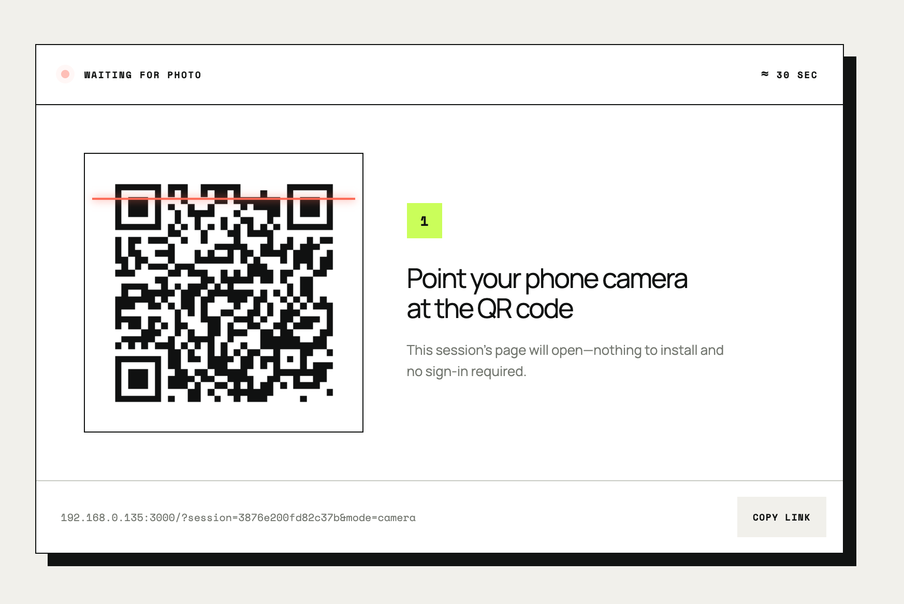
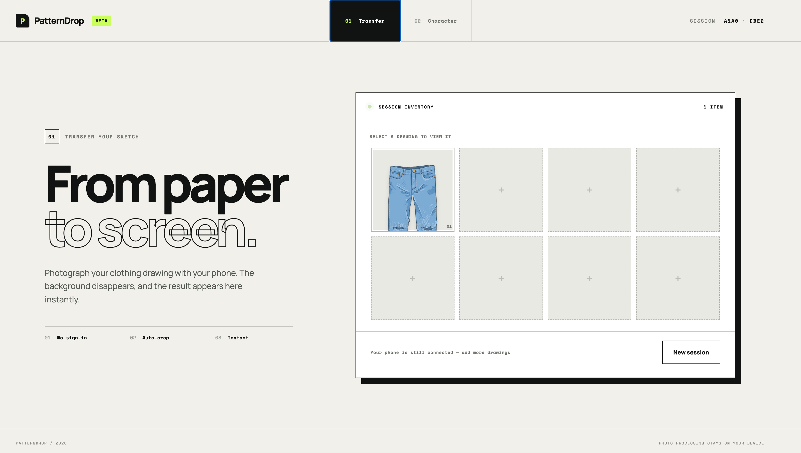
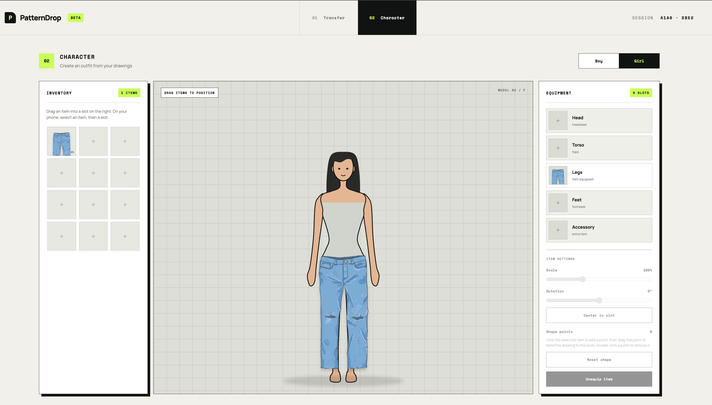
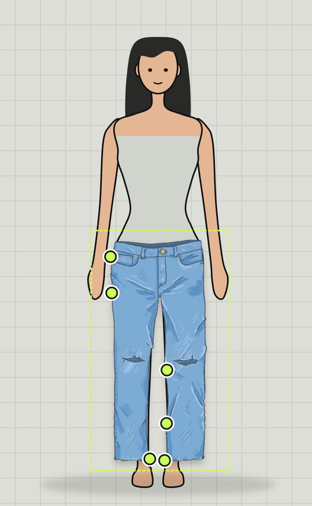

# PatternDrop

An app for transferring clothing drawings from paper to your computer’s browser. I built this app for my daughter. She loves drawing and dressing up dolls in different outfits. Now she can dress up characters in clothes she draws herself.

## How it works

1. The computer generates a random 16-character session ID, registers it with the server and displays a QR code.
2. The QR code opens a mobile page with the same ID—no account or sign-in required. The phone first checks that the server knows the session; links to unknown or expired sessions show “Session not found” and cannot take or send photos.
   The phone can take a new photo or pick one from the gallery, including iPhone HEIC photos: browsers without native HEIC support decode them with `heic-to` (libheif/WebAssembly, LGPL-3.0), loaded only when needed.
3. The phone estimates the paper color from local image tiles and uses a Canvas flood fill starting at the image edges. Only the connected outer background is removed; light areas inside closed drawing outlines are preserved. This runs in a Web Worker on `OffscreenCanvas` so the page stays responsive (on the main thread in browsers without it).
4. Each processed PNG is stored in `.data/images`; its session ID and dimensions are stored in `.data/patterndrop.sqlite`. Sessions unused for 7 days are deleted with their drawings.
5. The desktop page polls the API (paused while the tab is hidden) and displays all drawings in the session in an inventory grid. Selecting a drawing opens a preview that fits within the screen.
6. In the **Character** tab, you can drag drawings into RPG-style equipment slots and overlay them on a boy or girl model. Equipped items can be freely moved with a mouse or finger, scaled, and rotated in 1° increments. Clicking a selected item adds a shape point; dragging the point bends that part of the drawing to fit the body. The outfit is saved in the browser per session.

The workflow does not use ChatGPT, the OpenAI API, or third-party recognition services.

## Run locally

Requires Node.js 22.13 or later (`nvm use` picks it up from `.nvmrc`; `.npmrc` sets `engine-strict` so npm refuses older versions).

```bash
npm install
npm run dev
```

The required Node.js version is declared in `package.json` under `engines.node`. npm commands use the Node.js version active in your environment.

The app creates `.data/patterndrop.sqlite` and `.data/images` automatically. Set `PATTERNDROP_DATA_DIR` to store them elsewhere.

Set the URL encoded in the QR code in `.env.local`:

```env
NEXT_PUBLIC_SITE_URL=http://192.168.0.164:3000
```

After startup, the terminal displays two addresses: `Local` and `Network`. Open the **Network URL** on your computer (for example, `http://192.168.1.42:3000`) to use it in the QR code when no URL is configured in `.env.local`. Your phone and computer must be on the same Wi-Fi network. No internet deployment is needed.

If macOS asks whether Node.js may accept incoming connections, allow it. On guest Wi-Fi networks, client isolation may block communication between devices.

## Project structure

```
app/                     Routing only: layout, page, styles entry, API route
  api/sessions/[...path]/route.ts   Session API entry point
  reset.css, base.css    Base reset (from Tailwind's preflight) and app-wide styles
features/
  studio/                Picks the phone or desktop screen
  session/               Session ID, API client (api.ts), registration, polling, status
  transfer/              Desktop screen: QR handoff, inventory, lightbox
  capture/               Phone screen and upload flow
  image-processing/      Decoding (HEIC fallback), paper removal, cut-out worker
  character/             Character screen, wardrobe state and gestures
    warp/                Point-based warp math and canvas renderer
lib/hooks/               Generic client hooks (polling, persistent state, clipboard, Escape)
shared/                  Constants and types used by both client and server
server/                  SQLite storage and migrations, PNG validation, session API, cleanup
tests/                   Unit and server tests; tests/build/ needs `npm run build` first
```

Each feature keeps its components, hooks and stylesheet together; `app/globals.css` imports the stylesheets in a fixed order.

## Development

```bash
npm run dev            # dev server
npm run format         # format with Prettier
npm run lint
npm run typecheck
npm run test:unit      # fast: unit and server tests
npm test               # build, then all tests (what CI runs, with format:check, lint and typecheck)
```

CI runs on every push to `main` and on pull requests (`.github/workflows/ci.yml`).

## What does it look like

**Connect the phone.** The computer shows a QR code that opens the session on the phone.



**Session inventory.** Photographed drawings appear on the computer with the paper background removed.



**Character.** Drag drawings into equipment slots to dress the model, then scale and rotate them.



**Shape points.** Add points to an equipped item and drag them to bend the drawing to the body.


